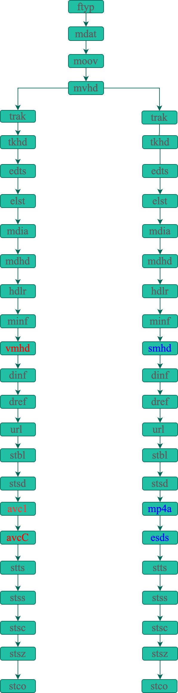
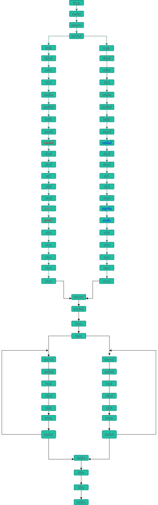

# Mp4Muxer

A minimal, dependency-free MP4 muxer written in C, built for learning the MP4 (ISO Base Media File Format, ISO/IEC 14496-12) protocol.

It reads raw H.264 and/or AAC-LC elementary streams and writes an MP4 file **box by box** — either a classic (non-fragmented) MP4 or a fragmented MP4 (fMP4). All boxes are written directly from the spec pseudocode, so every function maps to the corresponding section of ISO/IEC 14496-12 (see the comments in the source).

## Features

- **Input**: H.264 Annex B bitstream and/or AAC ADTS bitstream (video-only, audio-only, or both)
- **Output**: classic MP4 (`fragment=0`) or fragmented MP4 (`fragment=1`)
- **H.264 parsing** (`h264/`):
  - Scans Annex B start codes and indexes every packet (IDR/non-IDR) with its offset and size
  - Extracts SPS/PPS and decodes SPS syntax elements (profile/level/chroma format/bit depth) to fill `avcC`
  - Converts Annex B to AVCC (length-prefixed) samples via `annexb2mp4()`
- **AAC parsing** (`aac/`):
  - Parses ADTS headers and indexes every AAC frame
  - Derives the AudioSpecificConfig from the ADTS header for `esds`
- **fMP4 support** (`mp4/fmp4.c`):
  - Video is fragmented per GOP (a new fragment at every IDR frame)
  - Audio fragments are aligned to video fragment durations (or 3-second segments for audio-only)
  - `trun` is first written as a placeholder and patched afterwards with real offsets/sizes
  - `mfra` (tfra/mfro) is appended for random access and seeking

No external libraries are required — FFmpeg is only used to generate the test bitstreams.

## Requirements

- CMake ≥ 2.8 (tested with 3.x)
- A C compiler (gcc or clang)

## Build

```shell
mkdir build
cd build
cmake ..
make
```

The executable is `build/Mp4Muxer`.

## Usage

```shell
./Mp4Muxer input.cfg
```

Before running, edit `input.cfg` with your stream parameters. All file paths in the config are relative to the **current working directory** (the directory from which you invoke the binary):

```shell
cd build
./Mp4Muxer ../input.cfg    # paths in cfg resolve relative to build/
```

## Configuration

| Key             | Description                          | Example            |
| --------------- | ------------------------------------ | ------------------ |
| `videopath`     | H.264 Annex B bitstream file         | `../test/5s.h264`  |
| `width`         | video width                          | `1920`             |
| `height`        | video height                         | `1080`             |
| `framerate`     | frame rate as `num/den`              | `25/1` (25 fps)    |
| `videoduration` | video duration in seconds            | `5`                |
| `audiopath`     | AAC ADTS bitstream file              | `../test/5s.aac`   |
| `channelcount`  | audio channel count                  | `2`                |
| `samplerate`    | audio sample rate in Hz              | `48000`            |
| `audioduration` | audio duration in seconds            | `5`                |
| `outputpath`    | output MP4 file                      | `output.mp4`       |
| `fragment`      | `1` = fragmented MP4, `0` = classic  | `1`                |

Notes:

- Either `videopath` or `audiopath` may be omitted to mux video-only or audio-only.
- `videoduration`/`audioduration` are taken from the config (not measured from the bitstreams), so they must match the actual content duration.
- `framerate` is the reciprocal of the per-frame duration written into `stts`/`tfhd`: the muxer assumes a constant frame rate and does not write `ctts`.

## Generating test streams

The repo already contains `test/5s.h264` and `test/5s.aac` (5-second test clips), and `test/1.aac` (5-minute audio). The 5-minute `1.h264` is too large to commit — generate it with the first pair of commands below (see `test/gen.sh`):

```shell
# 1. five-minute streams (run inside test/)
ffmpeg -i input -an -r 25 -c:v libx264 -bf 0 -t 00:05:00 1.h264
ffmpeg -i input -vn -ar 48000 -ac 2 -t 00:05:00 1.aac

# 2. cut the first 5 seconds into test/5s.h264 and test/5s.aac
ffmpeg -i 1.h264 -c:v libx264 -x264-params keyint=25:no-scenecut=1 -bf 0 -t 00:00:05 5s.h264
ffmpeg -i 1.aac -t 00:00:05 5s.aac
```

The encoding flags matter for this muxer:

- `-bf 0` — no B-frames: the muxer writes a single constant `stts` delta and no `ctts`, so it only supports display order == decode order.
- `keyint=25:no-scenecut=1` — exactly one IDR every 25 frames (1 second at 25 fps): with `fragment=1` this gives one video fragment per GOP, which makes the fragment boundaries easy to observe.

## How it works

The muxing pipeline in `main.c` is:

1. **Parse config** (`get_stream_params`): reads `input.cfg`, allocates buffers.
2. **Parse bitstreams**: `h264_parse()` indexes every video packet and decodes SPS; `aac_parse()` indexes every ADTS frame.
3. **Write boxes**: `ftyp`, then — depending on `fragment` — the classic layout (`mdat` + `moov`) or the fragmented layout (`moov` + `moof`/`mdat` pairs + `mfra`).

### Classic MP4 (`fragment=0`)

```
ftyp
mdat                     # video samples (AVCC), then audio samples (raw AAC payload)
moov
├── mvhd                 # movie timescale = 1000
├── trak (video, id 1)
│   ├── tkhd
│   ├── edts ─ elst
│   └── mdia
│       ├── mdhd         # timescale = 12800
│       ├── hdlr
│       └── minf
│           ├── vmhd
│           ├── dinf ─ dref ─ url
│           └── stbl
│               ├── stsd ─ avc1 ─ avcC      # SPS/PPS + profile/level from SPS
│               ├── stts                    # constant frame duration
│               ├── stss                    # sync samples = IDR frames
│               ├── stsc                    # 25 samples per chunk
│               ├── stsz
│               └── co64                    # 64-bit chunk offsets
└── trak (audio, id 2)
    ├── tkhd
    ├── edts ─ elst
    └── mdia
        ├── mdhd         # timescale = sample rate
        ├── hdlr
        └── minf
            ├── smhd
            ├── dinf ─ dref ─ url
            └── stbl
                ├── stsd ─ mp4a ─ esds      # AudioSpecificConfig from ADTS header
                ├── stts                    # 1024 samples per frame
                ├── stsc                    # single chunk
                ├── stsz
                └── co64
```



The single `mdat` is written before `moov`, with all video samples first, then all audio samples (no interleaving).

### Fragmented MP4 (`fragment=1`)

```
ftyp                     # brands: isom, avc1, mp41, iso5
moov
├── mvhd
├── trak (video)         # mdhd duration = 0, empty sample tables
├── trak (audio)
└── mvex
    ├── mehd             # total fragment duration
    └── trex × 2         # one per track, all defaults 0
[moof + mdat] × N        # one pair per fragment
moof
├── mfhd                 # sequence number, starts at 1
└── traf
    ├── tfhd             # flags 0x2002a: description index, sample duration,
    │                    #   sample flags, base = moof
    ├── tfdt             # version 1 baseMediaDecodeTime
    └── trun             # version 1, data_offset + per-sample sizes
mdat
...
mfra                     # random access
├── tfra (video)         # (time, moof offset) per fragment
├── tfra (audio)
└── mfro                 # mfra size, patched at end
```



Fragmentation strategy:

- **Video**: each fragment starts at an IDR frame, i.e. one fragment per GOP.
- **Audio**: when muxed with video, audio fragments are aligned to the video fragment durations; audio-only streams are cut into 3-second segments (`g_audio_segment_duration` in `mp4/fmp4.c`).
- `trun` cannot know the sample sizes until the `mdat` is written, so it is first written as a placeholder (`write_trun_fake`), then patched in place with the real `data_offset` (relative to `moof`, per `default-base-is-moof`) and sample sizes after the `mdat` (`update_trun`).

## Code structure

```
Mp4Muxer
├── main.c                  # entry: config parsing, muxing pipeline
├── input.cfg               # example configuration
├── CMakeLists.txt
├── mp4/
│   ├── mp4.c / mp4.h       # classic MP4 box writers (ftyp/mdat/moov/…)
│   └── fmp4.c / fmp4.h     # fragmented MP4 (moof/traf/trun/mfra/…)
├── h264/
│   ├── h264parser.c / .h   # Annex B scanning, packet indexing, annexb2mp4
│   └── h264bsparser.c / .h # SPS bitstream parsing (ported from FFmpeg)
├── aac/
│   ├── aacparser.c / .h    # ADTS scanning, frame indexing, AudioSpecificConfig
│   └── aacbsparser.c / .h  # ADTS header parsing
├── util/
│   ├── util.c / .h         # big-endian IO, box size patching, string utils
│   └── bsreader.c / .h     # bitstream reader
└── test/                   # test bitstreams + gen.sh
```

Each `write_*()` function documents the box with the pseudocode from the spec, which makes the source readable alongside the standard.

## Limitations

- One video track and/or one audio track; H.264 (`avc1`) and AAC-LC (`mp4a`) only.
- No B-frames: `ctts` is not written, so decode order must equal presentation order.
- Constant frame rate assumed: one `stts` entry / one `tfhd` sample duration for the whole video.
- Annex B input only (no `avc3`/MP4 input); ADTS AAC input only (no raw AAC).
- A single SPS/PPS pair is kept (the last ones parsed) and written to `avcC`.
- Durations come from the config file, not from the bitstreams.
- `mvhd`/`tkhd`/`mdhd` are version 0 boxes (32-bit durations), so very long movies overflow.
- No interleaving: samples are laid out track-by-track inside `mdat`.
- `stco` is never written — `co64` (64-bit offsets) is always used instead.

## References

- ISO/IEC 14496-12 — ISO Base Media File Format (most box definitions; section numbers are cited in the source comments)
- ISO/IEC 14496-15 — AVC file format (`avcC` / AVCDecoderConfigurationRecord)
- ISO/IEC 14496-1 — MPEG-4 systems (`esds` descriptors)
- ISO/IEC 13818-7 — AAC (ADTS syntax)
- ITU-T H.264 — SPS syntax (the SPS parser in `h264/h264bsparser.c` is ported from FFmpeg)
- FFmpeg `movenc.c` — reference for `esds` writing

## License

MIT — see [LICENSE](LICENSE).
